Design engineer in Berlin. I design web products and build them with React, TypeScript and Cloudflare.

Portfolio: [clorostica.vercel.app](https://clorostica.vercel.app) · [LinkedIn](https://www.linkedin.com/in/claudia-saez-orostica-97221624b/)

## Where to start

<a href="https://github.com/Clorostica/Navi"></a>

[Live](https://navi-flax-nu.vercel.app) · [Code](https://github.com/Clorostica/Navi)

<a href="https://gobento.clorostica.com"></a>

[Live](https://gobento.clorostica.com)

<a href="https://github.com/Clorostica/Epica"></a>

[Live](https://epica-iota.vercel.app) · [Code](https://github.com/Clorostica/Epica)

## This repo

The code for my portfolio: React, Vite and Tailwind CSS, in English, Spanish and German.

```bash
npm install
npm run dev
```
