Design engineer in Berlin. I design web products and build them with React, TypeScript and Cloudflare.

Portfolio: [clorostica.vercel.app](https://clorostica.vercel.app) · [LinkedIn](https://www.linkedin.com/in/claudia-saez-orostica-97221624b/)

## Where to start

<picture>
  <source media="(prefers-color-scheme: dark)" srcset="https://github.com/Clorostica/Clorostica/raw/main/profile/navi-dark.svg">
  
</picture>

Companion app for Berlin's U-Bahn and S-Bahn. Riders report incidents, see live trains and share their trip with trusted contacts.

<a href="https://navi-flax-nu.vercel.app"><picture><source media="(prefers-color-scheme: dark)" srcset="https://github.com/Clorostica/Clorostica/raw/main/profile/navi-live-dark.svg"></picture></a>&nbsp;<a href="https://github.com/Clorostica/Navi"><picture><source media="(prefers-color-scheme: dark)" srcset="https://github.com/Clorostica/Clorostica/raw/main/profile/navi-code-dark.svg"></picture></a>

<picture>
  <source media="(prefers-color-scheme: dark)" srcset="https://github.com/Clorostica/Clorostica/raw/main/profile/gobento-dark.svg">
  
</picture>

Turns group-chat plans into one shareable link with date, place and guest list.

<a href="https://gobento.clorostica.com"><picture><source media="(prefers-color-scheme: dark)" srcset="https://github.com/Clorostica/Clorostica/raw/main/profile/gobento-live-dark.svg"></picture></a>&nbsp;<a href="https://github.com/Clorostica/Gobento"><picture><source media="(prefers-color-scheme: dark)" srcset="https://github.com/Clorostica/Clorostica/raw/main/profile/gobento-code-dark.svg"></picture></a>

<picture>
  <source media="(prefers-color-scheme: dark)" srcset="https://github.com/Clorostica/Clorostica/raw/main/profile/tabio-dark.svg">
  
</picture>

Team project. A browser extension that syncs bookmarks across Chrome, Firefox, Edge, Brave and Safari, end-to-end encrypted.

<a href="https://tabio.clorostica.com"><picture><source media="(prefers-color-scheme: dark)" srcset="https://github.com/Clorostica/Clorostica/raw/main/profile/tabio-live-dark.svg"></picture></a>

<picture>
  <source media="(prefers-color-scheme: dark)" srcset="https://github.com/Clorostica/Clorostica/raw/main/profile/epica-dark.svg">
  
</picture>

Brand identity and website for a Chilean fashion label.

<a href="https://epica-iota.vercel.app"><picture><source media="(prefers-color-scheme: dark)" srcset="https://github.com/Clorostica/Clorostica/raw/main/profile/epica-live-dark.svg"></picture></a>&nbsp;<a href="https://github.com/Clorostica/Epica"><picture><source media="(prefers-color-scheme: dark)" srcset="https://github.com/Clorostica/Clorostica/raw/main/profile/epica-code-dark.svg"></picture></a>

## This repo

The code for my portfolio: React, Vite and Tailwind CSS, in English, Spanish and German.

```bash
npm install
npm run dev
```
